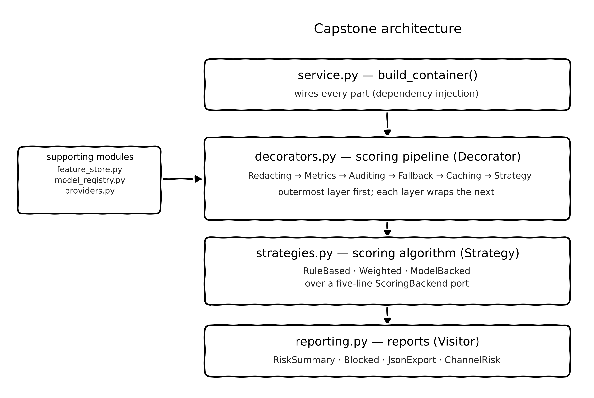

# e-Portfolio — Advanced Object-Oriented Design and Programming (AOODP)

**Student:** 12701559 · **Module:** Advanced Object-Oriented Design and Programming (AOODP)
**Artefact repository:** `capstone/` — nine modules, 2,512 statements, 355 offline tests, 99% statement coverage
**Companion artefact (Unit 6):** `unit6/` — thread-safe banking system, 39 tests
**Evidence:** `evidence/demo_run_output.txt`, `evidence/test_run_output.txt`, `evidence/coverage_report.txt`, `evidence/coverage_html/`

> The assessed narrative is Tasks 1–4 below; the reference list is excluded from the word
> count, as required. Tasks 1–4 total 2,711 words (guideline: 2,500 words equivalent effort).
> Repository links: <https://github.com/stacyalwangaessex/aoodp-capstone> and the module page
> at <https://stacyalwangaessex.github.io/aoodp-capstone/>.

---

## Task 1 – Summarise Key Learning Outcomes

The capstone is a transaction risk-assessment engine: transactions in, governance-instrumented decisions out. Appendix A maps every claim below to a file and a captured run.

### 1.1 Understand and implement secure coding practices

Security here is structural, not appended. **Construction-time validation:** `validation.py` centralises every check, and `Transaction` is a frozen slotted dataclass whose `__post_init__` calls those validators, so an invalid transaction cannot exist; errors never echo the rejected value, since reflecting untrusted input enables injection (OWASP Foundation, 2021). **Boundary minimisation:** `RedactingDecorator` is outermost, so no inner layer, audit sink included, sees a raw identifier. **Untrusted replies:** `ModelBackedScoringStrategy` rejects non-mapping, non-numeric or out-of-range scores.

### 1.2 Apply advanced object-oriented principles to complex problems

Five concerns are separated — features, algorithm, policy, lifecycle and format (`feature_store.py`, `strategies.py`, `decorators.py`, `model_registry.py`, `reporting.py`) — and joined only by the composition root in `service.py`. Encapsulation uses frozen value objects, polymorphism `RiskScoringStrategy` and `ReportVisitor`, abstraction a five-line `ScoringBackend` protocol, and constructor injection; algorithm, provider, model version and report format each change without editing a consumer.

### 1.3 Utilise design patterns for reusable, maintainable, flexible code

| Pattern | Where | Flexibility it buys |
|---|---|---|
| Strategy | `strategies.py` | Rules, statistical or model scoring by one config string |
| Decorator | `decorators.py` | Redaction, metrics, audit, caching, fallback composed at one point |
| Visitor | `reporting.py` | Reports added as classes; `ChannelRiskVisitor` touched no other file |
| Abstract Factory | `providers.py` | A provider family swapped together, consistency checked |
| Dependency Injection | `service.py` | Dependencies passed in, making tests deterministic |

Each pattern was chosen against a named rejected alternative.

### 1.4 Design architectures suitable for large-scale systems, ensuring security and robustness

Scaling follows the same separation: caching is an inner decorator that can become distributed without touching governance, and the registry centralises lifecycle state. Robustness is demonstrated, not asserted: a provider outage yields three transport attempts, an explicit `[degraded: primary unavailable]` rationale and a substituted decision that still reaches the audit trail, while an illegal `archived -> production` promotion is refused.

### 1.5 Develop software adaptable for AI models and efficient for data science tasks

Three properties were designed in. **Abstraction:** the AI layer is reached only through `ScoringBackend`, so swapping a hosted LLM for a local one is a composition-root change. **Contracts:** `StrategyOutput` carries `contributions` and `rationale`, making explainability part of the algorithm contract, while `FeatureDefinition` is named, versioned and owned, so training and serving share definitions. **Lifecycle:** the registry makes model version a runtime fact, the precondition for shadow deployment and rollback.

### 1.6 Link to practical work

Secure coding appears in `validation.py`, `domain.py` and `RedactingDecorator` (run sections 5–6); the four classic patterns in one engine, each critiqued in Task 2; large-scale robustness in the `build_risk_service` root; and AI adaptability in `model_registry.py` and `feature_store.py`, where run section 7 changes the live version with no code change. Unit 6 supplies the concurrency foundation: `FeatureStore` takes a re-entrant lock because `compute_vector` calls `get` internally, where a plain `Lock` would self-deadlock.

## Task 2 – Showcase Artefacts

Repository: `https://github.com/stacyalwangaessex/aoodp-capstone`. The e-Portfolio is also published as a module page through GitHub Pages at `https://stacyalwangaessex.github.io/aoodp-capstone/`. Code is cited as artefact evidence rather than reproduced.

### 2.1 Artefact A — Thread-safe concurrent programming (Unit 6)

`bank_account.py` and `transaction_simulator.py` with 39 tests: an account mutated under a re-entrant lock, a transfer service and a concurrent simulator. **Principles:** encapsulated state, custom exception types, and a re-entrant lock so a guarded method calling another guarded method cannot deadlock. **Challenge:** the simulator's first figures did not reconcile with its screenshot, teaching me to reproduce evidence rather than remember it.

### 2.2 Artefact B — Strategy: interchangeable scoring algorithms

`RiskScoringStrategy` defines `score(features, model_ref) -> StrategyOutput`, implemented three ways: rule-based, weighted-statistical and model-backed through `ScoringBackend`. A fraud engine must run an explainable rule set in one environment and a learned model in another, so `StrategyOutput` is uniform and `contributions` records which inputs drove the number, letting an auditor reconstruct a decision without the model. **Critical commentary.** An algorithm rejecting a transaction outright must therefore encode that in `contributions` — chosen over pushing policy into the algorithms.

### 2.3 Artefact C — Decorator: dynamic governance layers

Five layers — `RedactingDecorator`, `MetricsDecorator`, `AuditingDecorator`, `CachingDecorator`, `FallbackDecorator` — are composed by `compose_scoring_pipeline()`, the single assembly point. **Critical commentary — a defect found and fixed.** Assembly originally placed `AuditingDecorator` *inside* `FallbackDecorator`; every per-decorator test still passed, and the defect appeared only when a test asserted that a degraded decision reaches the audit sink, which it did not. The fix moves auditing outside the fallback, and the docstring records why.

### 2.4 Artefact D — Visitor: analytics and reporting

`ReportVisitor` declares `visit_batch`, `visit_scored_transaction` and `result`; four visitors run through a `render(batch, visitor)` driver. Elements are immutable value objects that should not accumulate report logic, while reporting adds operations repeatedly: a new report is one class and no edit to the elements. **Critical commentary.** A new element type would force every visitor to change, acceptable because the hierarchy is closed; the subtler risk is redaction drift, asserted absent by the run.

### 2.5 Artefact E — Abstract Factory: swapping AI service providers

`AiProviderFactory` creates a family — config, backend and explanation generator — in local heuristic and hosted LLM variants, both around an injected transport callable, and `assemble()` returns it only after a consistency check, because a hosted endpoint with redaction off is a contradiction. **Critical commentary.** With two families this is arguable, but the family relationship is the real invariant. Nothing in `strategies.py` or `service.py` imports a vendor SDK, so the remote path is exercised offline.

### 2.6 Artefacts F and G — Model Registry and Feature Store

**Registry** (`model_registry.py`). `ModelRecord` is immutable and `ModelRegistry` enforces `_ALLOWED_TRANSITIONS`; run section 7 shows 2.1.0 live, 2.2.0 registered, promoted through `STAGING` to `PRODUCTION`, 2.1.0 archived, and the next decision recording `transaction-risk:2.2.0`. **Defect found and fixed:** `promote()` returned the updated record without writing it back, so single-call tests passed; it surfaced only when a test promoted a version then asked what was live, because asserting on a return value cannot detect a missing state mutation. **Feature Store.** `FeatureDefinition` backs a lock-guarded store of seven features. **Critical commentary.** Refusing to treat a missing feature as zero was decisive: a rule whose feature is absent is skipped, not given a fabricated value.

### 2.7 Artefact H — Dependency Injection and inversion of control

`RiskAssessmentService` takes its component, feature store, feature names, context provider and explainer as constructor arguments; `ServiceContainer` is a minimal locator with explicit factories and a loud `ValidationError`, and `build_risk_service()` is the composition root. **Critical commentary.** A framework container would be over-engineering at this size, so it stays about 45 lines; a locator hides dependencies from the type checker, so it stays at the outer edge (Fowler, 2004).

### 2.8 Artefact I — Testing: mocking and AI-assisted testing without live models

`capstone/tests/` holds nine modules and 355 tests at 99% coverage of 2,512 statements, all offline, with doubles named by category — stubs, a fake, spies (Python Software Foundation, 2026). **Reflection on AI-assisted testing.** An assistant drafted tests from class contracts and found a boundary case I had not enumerated: a boolean score, an `int` in Python, which would otherwise pass `isinstance`. It also produced confidently wrong assertions, such as expecting one masked character where all but the last four are masked. Neither was detectable by reading the test, only by running it and understanding why it failed.

### 2.9 Capstone: scalable architecture, robustness and AI-readiness

*Scalability:* feature computation is pure and parallelisable, caching is an inner decorator replaceable by a distributed cache, and provider families isolate network mechanics behind one callable. *Robustness and AI-readiness:* 355 deterministic tests assert degradation reaching the audit trail, redaction before any payload is seen, malformed replies rejected and illegal transitions refused.

Figure 1 shows the composition root, the decorator chain in its defended order, the strategy/backend seam, the adapters and the visitor.

*Running-system evidence:* `evidence/demo_run_output.txt` captures eight sections — a six-transaction batch (two `allow`, three `review`, one `block`); audit records with no identifier; masking before egress (`GB33BUKB20201555555555` → `******************5555`); and a provider outage with a three-attempt retry budget.

### 2.10 Cross-cutting critical commentary

**Trade-offs.** Every pattern was chosen against a rejected alternative: Strategy over a scorer hierarchy, Decorator over subclass combinations, Visitor over report methods, Abstract Factory over a factory function. **Testing complexity.** Both defects were cases where tests were individually correct and the system collectively wrong.

## Task 3 – Reflection on Skill Development

An e-Portfolio is a curated, purposeful collection of evidence rather than a chronological stack of exercises (Lorenzo and Ittelson, 2005), which is why every claim below is tied to a named artefact or capture.

### 3.1 Academic skills

**Critical thinking.** The formative experience was the composition-order defect. My first reaction was to distrust the test; the correct reaction was to distrust the design. I now ask what a passing test *cannot* see before asking whether it should pass, and applied to the registry defect that question produced my working rule about observing state through a second access path.

**Ethical considerations in AI-driven OO design.** *Bias propagation:* policy lives in data rather than a class hierarchy, so rule weights and thresholds are inspectable, versionable values a reviewer can read directly. The residual risk is real: those weights are expert-set rather than learned, so they encode the blind spots of whoever set them — the engine makes bias inspectable, not absent. *Transparency:* `rationale` and `contributions` are contract fields, so an algorithm that cannot say which inputs drove its number cannot conform. *Black-box coupling:* `ScoringBackend` is five lines with no vendor concepts, and no domain module imports a vendor SDK. *Auditability:* every decision produces a structured record — component, model version, score, decision, rationale — asserted by the run to contain no account or customer identifier.

**Problem-solving and refactoring.** Refactoring was driven by measurable signals rather than taste: extracting `validation.py` removed duplication across five modules and made the security rules auditable in one file, and extracting `compose_scoring_pipeline()` collapsed four copies of an ordering decision into one documented function. I also resisted over-refactoring: a shared base class for the reporting visitors would create inheritance without polymorphism.

**Research and self-study.** Reading fell into three groups: pattern sources (Gamma *et al.*, 1994; Martin, 2000, 2017; Fowler, 2004, 2018) for vocabulary and named trade-offs; AI-systems sources (Sculley *et al.*, 2015; Mitchell *et al.*, 2019) for the feature-store and registry arguments; and risk and fairness sources (Aven and Thekdi, 2025; Barocas, Hardt and Narayanan, 2023). The most useful outcome was negative: none of the pattern literature treats governance layers — audit, redaction, degradation — as first-class composition concerns, so the pipeline-order reasoning here came from analysing my own failure modes.

### 3.2 Employability skills

**Time management.** No single session could hold the whole assessment, so I worked in artefact-sized increments, capturing evidence alongside construction rather than reconstructing it at the end. My concrete failure was underestimating test-writing: closing coverage from 87% to 99% took three modules and 143 tests and produced the two most valuable findings in the portfolio, which argues for budgeting test time as design time.

**Communication and literacy.** The clearest gain was writing docstrings that carry a decision rather than a description: `compose_scoring_pipeline` states the order and justifies each position. Writing the degradation marker as a machine-readable prefix (`[degraded: primary unavailable]`) was also a communication decision, since the same form is legible to an operator, a downstream consumer and a test.

**Resilience and interpersonal skills.** Resilience meant sitting with a failing test I believed was correct for longer than was comfortable, and changing the design instead of the assertion. On collaboration I must be explicit about the limits of my evidence: this is individual work, and Appendix B records what evidence of independent working is held. The transferable lesson survives that limitation: writing the decorator ordering decision down as a reviewer would demand forced me to state an intuition I had only relied on, which is why the assembly point is now documented rather than conventional.

## Task 4 – Professional Development Plan

### 4.1 Strengths and areas for improvement

| Strengths (evidenced) | Areas for improvement (evidenced) |
|---|---|
| Nine modules with clear boundaries and one composition root naming concrete types | Documentation of intent is uneven — reasoning sits in docstrings, not one design record |
| Test discipline as a design tool: 355 offline tests at 99% coverage | Test-*shape* thinking arrived late; two defects escaped individually correct tests |
| Security as structure: immutable validated domain objects, boundary redaction | Data-side depth: fairness metrics and drift detection understood conceptually, not implemented |
| Registry and feature store implemented, not merely named | Operational thinking: retries, fallback and audit exist, but no monitoring artefact |
| Honest scoping: abstractions rejected, residual risks documented | Early drafts were descriptive and had to be cut towards reasoning |

### 4.2 Future goals and actions

**Goal 1 — AI-aware software architecture.** *Certification:* AWS Certified Machine Learning Engineer – Associate, which forces the operational vocabulary — monitoring, endpoint scaling, drift — my design assumes someone else provides. *Reading:* Sculley *et al.* (2015) with a design-review lens, Kleppmann (2017) for the distributed-systems reasoning a durable registry needs, and the MLflow (MLflow, 2026) and Feast (Feast, 2026) documentation as reference implementations. *Applied project:* a persistent registry with an append-only promotion audit, and drift detection added as a new visitor.

**Goal 2 — Advanced testing strategies for intelligent systems.** *Reading and practice:* property-based testing with Hypothesis (Hypothesis, 2026), because the defect classes I hit — missing state mutation, wrong composition order — are exactly what property-based testing targets, and a property asserting that the registry's production version always equals the last promoted one would have caught the registry defect. *Skill:* contract testing for `ScoringBackend`. *Applied project:* an evaluation harness comparing `rules-v1` against a trained model on held-out data, reporting accuracy and fairness metrics per subgroup.

**Goal 3 — Ethical software engineering in AI-integrated applications.** *Reading:* Barocas, Hardt and Narayanan (2023) properly rather than selectively; the NIST AI Risk Management Framework (NIST, 2023) as a governance structure for the audit and registry design; and the EU AI Act's high-risk obligations (European Parliament and Council, 2024), since credit scoring is a named high-risk category. *Practice:* adopt model cards (Mitchell *et al.*, 2019) as required artefacts for every registered version, extending `ModelRecord` with a required promotion rationale. *Applied project:* implement the fairness evaluation as a fifth reporting visitor, making bias a repeated measurement.

### 4.3 Reflective model applied — Gibbs' Reflective Cycle

Gibbs (1988) frames the event that produced the most learning: the composition-order defect. Kolb's (1984) cycle, the Johari Window (Luft and Ingham, 1955) and Bloom's revised taxonomy (Anderson and Krathwohl, 2001) were the alternatives; Gibbs was chosen because the trigger is one bounded failure whose cause can be traced.

**1. Description.** I had assembled the pipeline and written a test module per decorator; all passed. I then wrote a test asserting that when the hosted provider is unreachable, the degraded decision still reaches the audit trail. It failed: the sink recorded nothing for that transaction.

**2. Feelings.** First frustration and a suspicion the new test was wrong, because the per-decorator tests were green, giving way to unease on inspecting the assembly code, where the ordering was plainly visible. The discomfort marked the moment my mental model shifted from "a chain of layers" to "a chain of layers *with governance positioned relative to failure*".

**3. Evaluation.** The immediate cause was that `AuditingDecorator` wrapped the strategy before `FallbackDecorator` wrapped the result, so the substituted decision was produced outside the auditor. The deeper cause was that four places assembled the pipeline, making the ordering an implicit convention nobody could review; without the injectable sink the defect would have surfaced in production as an incident, not a design error.

**4. Analysis.** The Decorator pattern's strength — composable, independent layers — is also its characteristic hazard: correctness depends on ordering, and ordering is invisible to the type system because every decorator shares one type. Consolidating assembly into one documented function converts a hidden convention into a reviewable artefact. Mitchell *et al.* (2019) argue a model's intended use should be a first-class artefact; the equivalent here is that each layer's *position relative to failure* deserves the same explicitness.

**5. Conclusion.** Individually correct tests can sum to a collectively incorrect system, and that is a design smell rather than a testing gap. Two rules followed and now apply in this codebase: governance layers are positioned relative to failure modes with the positioning documented at the assembly point, and every stateful component has at least one test reading state back through a different path from the one it wrote through.

**6. Action plan.** Next project I will (i) write the assembly function before the individual layers, so the ordering is decided once and deliberately; (ii) write one integration test per *failure mode* rather than per class; and (iii) re-read every assembly point at review asking "what does this ordering make invisible?".

---

## References

Anderson, L.W. and Krathwohl, D.R. (2001) *A Taxonomy for Learning, Teaching, and Assessing: A Revision of Bloom's Taxonomy of Educational Objectives*. New York: Longman.

Aven, T. and Thekdi, S. (2025) *Risk Science: An Introduction*. 2nd edn. Abingdon: Routledge.

Barocas, S., Hardt, M. and Narayanan, A. (2023) *Fairness and Machine Learning: Limitations and Opportunities*. Cambridge, MA: MIT Press.

European Parliament and Council (2024) Regulation (EU) 2024/1689 of the European Parliament and of the Council laying down harmonised rules on artificial intelligence (Artificial Intelligence Act). *Official Journal of the European Union*, L 1689. Available at: https://eur-lex.europa.eu/eli/reg/2024/1689/oj (Accessed: 17 October 2026).

Feast (2026) *Feast: Feature Store for Machine Learning*. Available at: https://docs.feast.dev/ (Accessed: 17 October 2026).

Fowler, M. (2004) *Inversion of Control Containers and the Dependency Injection Pattern*. Available at: https://martinfowler.com/articles/injection.html (Accessed: 17 October 2026).

Fowler, M. (2018) *Refactoring: Improving the Design of Existing Code*. 2nd edn. Boston, MA: Addison-Wesley.

Gamma, E. *et al.* (1994) *Design Patterns: Elements of Reusable Object-Oriented Software*. Boston, MA: Addison-Wesley.

Gibbs, G. (1988) *Learning by Doing: A Guide to Teaching and Learning Methods*. Oxford: Further Education Unit, Oxford Polytechnic.

Hypothesis (2026) *Hypothesis: Property-Based Testing for Python*. Available at: https://hypothesis.readthedocs.io/ (Accessed: 17 October 2026).

Kleppmann, M. (2017) *Designing Data-Intensive Applications*. Sebastopol, CA: O'Reilly Media.

Kolb, D.A. (1984) *Experiential Learning: Experience as the Source of Learning and Development*. Englewood Cliffs, NJ: Prentice Hall.

Lorenzo, G. and Ittelson, J. (2005) *An Overview of E-Portfolios*. Boulder, CO: Educause Learning Initiative.

Luft, J. and Ingham, H. (1955) 'The Johari window: a graphic model of interpersonal awareness', *Proceedings of the Western Training Laboratory in Group Development*. Los Angeles: University of California.

Martin, R.C. (2000) *Design Principles and Design Patterns*. Available at: https://web.archive.org/web/20150906155800/http://www.objectmentor.com/resources/articles/Principles_and_Patterns.pdf (Accessed: 17 October 2026).

Martin, R.C. (2017) *Clean Architecture: A Craftsman's Guide to Software Structure and Design*. Boston, MA: Prentice Hall.

Mitchell, M. *et al.* (2019) 'Model cards for model reporting', *Proceedings of the Conference on Fairness, Accountability, and Transparency (FAT\* '19)*, pp. 220–229. doi:10.1145/3287560.3287596.

MLflow (2026) *MLflow Model Registry*. Available at: https://mlflow.org/docs/latest/model-registry.html (Accessed: 17 October 2026).

National Institute of Standards and Technology (NIST) (2023) *Artificial Intelligence Risk Management Framework (AI RMF 1.0)*. NIST AI 100-1. Gaithersburg, MD: NIST.

OWASP Foundation (2021) *OWASP Top 10:2021 – The Ten Most Critical Web Application Security Risks*. Available at: https://owasp.org/Top10/ (Accessed: 17 October 2026).

Python Software Foundation (2026) *unittest.mock — mock object library*. Available at: https://docs.python.org/3/library/unittest.mock.html (Accessed: 17 October 2026).

Sculley, D. *et al.* (2015) 'Hidden technical debt in machine learning systems', *Advances in Neural Information Processing Systems 28 (NIPS 2015)*, pp. 2503–2511.

## Appendix A — Artefact and evidence index

| # | Artefact | File(s) | Evidence | Task 2 |
|---|---|---|---|---|
| A | Thread-safe coding exercise (Unit 6) | `unit6/bank_account.py`, `unit6/transaction_simulator.py`, `unit6/test_banking_system.py` | 39 tests passing; simulator run output | 2.1 |
| B | Strategy pattern | `capstone/strategies.py` | `test_strategies.py`; run section 2 | 2.2 |
| C | Decorator pattern | `capstone/decorators.py` | `test_decorators.py`; run section 6a | 2.3 |
| D | Visitor pattern | `capstone/reporting.py` | `test_reporting.py`; run section 3 | 2.4 |
| E | Abstract Factory | `capstone/providers.py` | `test_providers.py`; run sections 6b–6c | 2.5 |
| F | Model Registry | `capstone/model_registry.py` | `test_model_registry.py`; run section 7 | 2.6 |
| G | Feature Store | `capstone/feature_store.py` | `test_feature_store.py`; run section 2 | 2.6 |
| H | DI / IoC | `capstone/service.py` | `test_service.py`; run section 8 | 2.7 |
| I | Mocking / AI-driven testing | `capstone/tests/conftest.py` + nine test modules | `evidence/test_run_output.txt`; `evidence/coverage_report.txt` | 2.8 |
| J | Secure validation layer | `capstone/validation.py`, `capstone/domain.py` | `test_validation.py`, `test_domain.py`; run section 5 | 1.1 |
| K | Runtime demonstration | `demo_run.py` | `evidence/demo_run_output.txt` (8 sections) | 2.9 |
| L | Coverage report | — | `evidence/coverage_html/index.html` | 2.8 |

## Appendix B — Evidence held in support of independent working

This submission is individual work, and this appendix records which supporting records are held for it. Each row names the record that would evidence that type of contribution; where no such record forms part of this submission, the entry says so rather than substituting an unevidenced claim.

| Evidence type | Record that would evidence it | Held for this submission |
|---|---|---|
| Repository contribution history | `git log --date=short` and `git shortlog -sne` for the submitted repository | Held — the commit history of this repository, summarised in `docs/git_contribution_history.txt` |
| Task ownership | A task board (Trello/Jira/GitHub Projects) showing item ownership and state | Not part of this submission |
| Meeting records | Dated minutes or notes recording actions taken | Not part of this submission |
| Peer review | Comments given and received on another person's artefact | Not part of this submission |
| Tutor feedback | Feedback on drafts, with the response to it | Not part of this submission |
| Independent working | A dated study log or planner extract showing the working schedule | Not part of this submission |

## Appendix C — Honest statement of limits

1. **The default rule weights are expert judgement, not evidence.** The weights and the elevated-category set are plausible values, not values derived from data. They are versioned and inspectable, but inspectable is not validated, and the fairness risk described in Task 3 lives here.
2. **The model-backed path is exercised against test doubles, never a real model.** This is deliberate — no API keys, no cost, no network — and it validates the integration contract thoroughly. It does not validate that any real model answers correctly; the hosted transport is the seam where that would change.
3. **The registry and feature store are in-memory.** They demonstrate lifecycle and versioning semantics with concurrency safety, but durability, migration and multi-process consistency are out of scope, which is why Goal 1 names a persisted registry as the next applied project.
